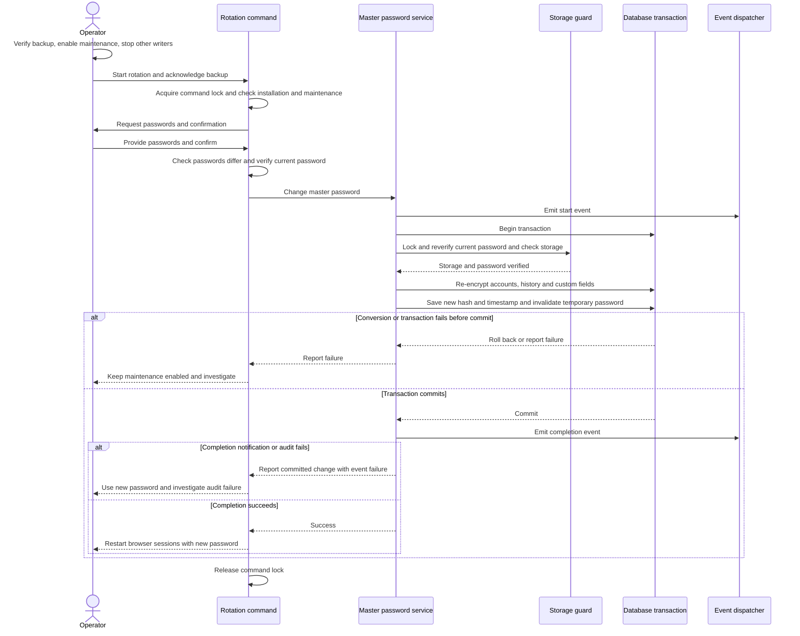

# Changing the master password

The full master password change is performed with `sp:crypt:update-master-password`
in the CLI. The Web interface does not provide a master-password change or a
manual hash-only update.

## Change sequence

The diagram shows the current CLI rotation flow. The operator prepares and
verifies the backup; the command requires acknowledgement but does not verify it.

If the commit outcome is uncertain, follow the recovery guidance below before
retrying. Preflight failures stop the operation before conversion.

Before starting, take and verify a recoverable database and configuration backup,
enable maintenance mode, and wait for other requests and jobs to finish. Ensure
that the database account can see triggers on the affected tables. The command
checks for InnoDB tables and requires explicit `TRIGGER` privileges on Account,
AccountHistory, CustomFieldData and Config; it refuses to run if those tables have
triggers. It also refuses to run if PluginData or AuthToken contains records:
plugin data and API token vaults use the master password but are not yet migrated
by this operation. Do not delete plugin data to bypass this safeguard; arrange a
separate migration before changing the password. API authorizations must be
revoked and recreated after the change if their loss is acceptable.

The first request after upgrading initializes a coordination row in `Config`.
This one-time step requires InnoDB, a trigger-free `Config` table, and `TRIGGER`
privilege to verify that no hidden trigger exists. If these conditions are not
met, requests fail closed; an administrator must resolve them before retrying.
Once initialized, ordinary requests do not require `TRIGGER` privilege, although
the rotation command still checks the privileges described above.

Coordinated Web, API and CLI writes hold the shared activity lock for the write
transaction. If the request's lock connection is lost, subsequent writes fail;
an in-flight write keeps rotation waiting until it commits or rolls back. Stop
older application instances, direct SQL writers and database upgrade jobs before
rotation, since they may not participate in this coordination.

The application automatically upgrades a weaker bcrypt master-password hash
after successful verification. It does not change the master password, the
password-change timestamp, or encrypted data. A compare-and-swap update keeps
concurrent changes intact; a concurrent hash for a different password makes the
request fail rather than continue with a stale key. Stronger bcrypt hashes are not downgraded, and other
hash algorithms are not migrated automatically. The upgrade is skipped, with a
warning in the application log, if Config is not InnoDB, has triggers, cannot be
inspected with the database account's TRIGGER privilege, or cannot be updated.
Successful verification continues to work with the existing hash in that case.

New master-password hashes use a versioned full-input verifier. For unversioned
legacy master hashes, verification rejects candidates of at least 72 bytes and
at most 72 characters, and 64-character lowercase hexadecimal candidates.
Bcrypt truncation and the old SHA-256 prehash make these candidates ambiguous.
The restriction also applies to the master hashes stored with account history.
Existing hashes of longer passwords that used the legacy prehash can still be
verified with the complete password. User passwords, API token passwords and XML
export passwords retain their legacy verification behavior.

If a known master password is rejected because its legacy hash is ambiguous,
enable maintenance mode, stop all writers and preserve the database and matching
configuration. Restore a verified, compatible backup in an isolated environment
if losing newer changes is acceptable. Otherwise keep the system in maintenance
and arrange recovery with a maintainer; there is no automated bypass for this
case. A safe conversion must use the known complete password, inventory every
current account, history entry and encrypted custom field, verify and convert
every affected record, and abort and restore the backup on any mismatch or
conversion failure. Verify the complete inventory and the new configuration
before returning the system to service. Do not replace the hash alone.

Do not rely on a prior release's master-password rotation for this recovery:
older versions can skip history records whose stored hash differs from the
current configuration hash and still report completion. Representative checks
cannot prove the conversion is complete. Prior releases also cannot verify the
new master-hash format; a downgrade must use a verified matching pre-upgrade
database and configuration or a separately reviewed conversion. Keep old XML
exports and their passwords with their backups; exports and API tokens made by
this version retain the legacy format. If a token must be retired, revoke and
recreate it using the supported authorization workflow.

If the stored master-password hash is missing, damaged, or no longer matches the
known current password, automatic rehashing cannot verify it and will not replace
it. Enable maintenance mode and stop other requests. Preserve the current
database and configuration for investigation, then restore a verified backup
of the database and configuration together from the same point in time. In an
isolated environment, use the password belonging to that backup to verify login
and representative encrypted data before returning it to service. This may
discard changes made after the backup. If preserving those changes is necessary,
keep the system in maintenance and arrange a controlled recovery with a
maintainer; do not guess a password or overwrite the hash from a stale session.
There is no Web action for manually replacing the hash.

Run `php cli.php sp:crypt:update-master-password` in the normal application PHP
runtime. Enter passwords at the hidden prompts and explicitly confirm that a
recoverable backup exists. For unattended invocations, `--update` no longer
suffices: add `--acknowledge-backup` after the backup has been verified. Supply
secrets through a protected environment rather than command-line arguments.
Existing automation must be updated for the new acknowledgement.

The operation stops if a record cannot be converted or if its recorded master
password hash does not match. Resolve the identified record before retrying.
If the command reports that the password changed but the completion audit event
failed, the database transaction committed: use the new password and investigate
the audit failure rather than retrying with the old password.
After success, restart browser sessions; users need the new master password.
Any existing temporary master password is invalidated. Generate and distribute a
new temporary password if users need one.

If execution is interrupted, the database connection is lost, or the result of
commit is uncertain, keep maintenance mode enabled and do not blindly retry.
Determine whether the transaction committed and verify both password configuration
and representative encrypted data using a controlled recovery process. If the
state cannot be established or is inconsistent, restore the verified pre-change
backup of the database and configuration together, retain the old password, and
investigate the failure before trying again. A backup is also necessary for
storage or server failures that database transactions cannot recover from.
